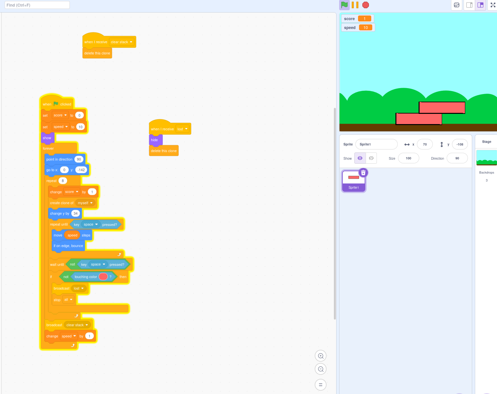

#+hugo_base_dir: ../
#+hugo_section: programming/teaching/scratch
* Scratch
:PROPERTIES:
:EXPORT_FILE_NAME: _index
:ID:       d08c9c2b-9a3a-41d5-be6b-d3c285f6b18c
:END:
** Scratch Index Page
Lesson materials on scratch
* Stacking Game
:PROPERTIES:
:EXPORT_FILE_NAME: stacking-quiz
:END:
** Stacking Game
This is a simple project that's made in scratch where the user needs to stack up rectangular blocks up in the sky. This project requires code to be put into one sprite and programming structures such as:

1. variables - setting and changing
2. forever loop
3. repeat and repeat until
4. if-statements and boolean expressions as condition

#+hugo_paired_shortcodes: %details
#+attr_shortcode: :title Stacking Project Full Solution (Teacher Only While In Session)
#+begin_details

#+end_details
** Debrief
Quiz is another word for debrief. This quiz tests your understanding of the programming structures used in this project.

Use questions 1–6 as fundamental understanding, 7–10 for events and clones, and 11–12 for applying multiple programming concepts together.

| Activity                 | Duration  | Purpose                           |
|--------------------------+-----------+-----------------------------------|
| Quiz *without* Scratch   | 10–12 min | Test understanding and recall     |
| Quiz *with* Scratch      | 10–15 min | Experiment and verify predictions |
| Review answers           | 5–8 min   | Explain misconceptions            |
| Let's Add Something More | 25–35 min | Apply knowledge creatively        |

*** 1. What does this block do?

#+BEGIN_SRC scratch
set [speed v] to (10)
#+END_SRC

- A. Adds 10 to the current speed
- B. Changes speed to exactly 10
- C. Multiplies speed by 10
- D. Moves the sprite 10 steps

#+attr_shortcode: :title Answer (Multiple Choice)
#+begin_details
B. Changes speed to exactly 10.

The =set= block replaces the current value of a variable with a new value.
#+end_details

*** 2. What will the value of score be after these blocks execute?

#+BEGIN_SRC scratch
set [score v] to (0)
change [score v] by (1)
change [score v] by (1)
change [score v] by (1)
#+END_SRC

- A. 0
- B. 1
- C. 3
- D. 4

#+attr_shortcode: :title Answer (Multiple Choice)
#+begin_details
C. 3.

The score starts at 0 and increases by 1 three times.
#+end_details

*** 3. Which statements about this loop are correct?

#+BEGIN_SRC scratch
repeat (8)
    change y by (34)
end
#+END_SRC

- A. The sprite moves upward 8 times.
- B. The sprite's y-coordinate increases by 272 in total.
- C. The sprite's x-coordinate increases by 34.
- D. The instructions inside the loop execute exactly 8 times.

#+attr_shortcode: :title Answer (Select All)
#+begin_details
A, B, and D.

Each repetition increases y by 34, so the total change is 8 × 34 = 272. The x-coordinate is unchanged.
#+end_details

*** 4. What happens when the space key is pressed?

#+BEGIN_SRC scratch
repeat until <key [space v] pressed?>
    move (10) steps
end
#+END_SRC

- A. The sprite begins moving faster.
- B. The sprite stops repeating the movement.
- C. The sprite moves exactly 10 more times.
- D. The entire Scratch project stops.

#+attr_shortcode: :title Answer (Multiple Choice)
#+begin_details
B. The sprite stops repeating the movement.

The loop continues while the condition is false. Once the space key is pressed, the loop ends.
#+end_details

*** 5. Which condition makes the sprite move when the space key is NOT pressed?

A.
#+BEGIN_SRC scratch
<key [space v] pressed?>
#+END_SRC

B.
#+BEGIN_SRC scratch
<not <key [space v] pressed?>>
#+END_SRC

C.
#+BEGIN_SRC scratch
<touching [edge v]?>
#+END_SRC

D.
#+BEGIN_SRC scratch
<mouse down?>
#+END_SRC

#+attr_shortcode: :title Answer (Multiple Choice)
#+begin_details
B.

The =not= operator reverses a Boolean condition. When the space key is not pressed, the inner condition is false, making the whole condition true.
#+end_details

*** 6. What happens when the sprite touches the edge?

#+BEGIN_SRC scratch
move (10) steps
if on edge, bounce
#+END_SRC

- A. The sprite disappears.
- B. The sprite stops permanently.
- C. The sprite changes direction to bounce away.
- D. The sprite returns to the center of the stage.

#+attr_shortcode: :title Answer (Multiple Choice)
#+begin_details
C. The sprite changes direction to bounce away.

The =if on edge, bounce= block adjusts the sprite's direction when it touches the stage boundary.
#+end_details

*** 7. Which events can start a Scratch script?

A.
#+BEGIN_SRC scratch
when green flag clicked
#+END_SRC

B.
#+BEGIN_SRC scratch
when I receive [lost v]
#+END_SRC

C.
#+BEGIN_SRC scratch
when I start as a clone
#+END_SRC

D.
#+BEGIN_SRC scratch
set [score v] to (0)
#+END_SRC

#+attr_shortcode: :title Answer (Select All)
#+begin_details
A, B, and C.

These are event blocks that can begin scripts. Setting a variable changes data but does not start a script by itself.
#+end_details

*** 8. What does broadcasting a message do?

#+BEGIN_SRC scratch
broadcast [lost v]
#+END_SRC

- A. Sends a message that can trigger other scripts.
- B. Deletes all clones immediately.
- C. Changes the score to zero.
- D. Ends every running script.

#+attr_shortcode: :title Answer (Multiple Choice)
#+begin_details
A. Sends a message that can trigger other scripts.

Scripts beginning with =when I receive [lost v]= can respond to this broadcast.
#+end_details

*** 9. What happens when this script executes?

#+BEGIN_SRC scratch
when I receive [lost v]
hide
delete this clone
#+END_SRC

- A. Every sprite in the project is deleted.
- B. The sprite becomes visible.
- C. The current clone hides and deletes itself.
- D. The game restarts automatically.

#+attr_shortcode: :title Answer (Multiple Choice)
#+begin_details
C, if this script is running on a clone.

The =hide= block makes the current sprite instance invisible. The =delete this clone= block removes the current clone. If the original sprite runs the script, it hides, but the original sprite is not deleted.
#+end_details

*** 10. What is the purpose of creating a clone in this stacking game?

#+BEGIN_SRC scratch
create clone of [myself v]
change y by (34)
#+END_SRC

- A. Create another copy of the sprite while moving the original upward.
- B. Move every existing sprite upward by 34.
- C. Replace the original sprite with a new costume.
- D. Create a completely new Scratch variable.

#+attr_shortcode: :title Answer (Multiple Choice)
#+begin_details
A.

A clone is another instance of the sprite. After creating it, the original sprite continues executing and moves upward by 34.
#+end_details

*** 11. Which statements about this condition are correct?

#+BEGIN_SRC scratch
if <not <touching color [#ff0000]?>> then
    broadcast [lost v]
end
#+END_SRC

- A. The broadcast happens when the sprite is not touching red.
- B. The broadcast happens every time the sprite touches red.
- C. The =not= operator reverses the result of the touching-color test.
- D. The broadcast happens only if the entire condition is true.

#+attr_shortcode: :title Answer (Select All)
#+begin_details
A, C, and D.

The touching-color test checks whether the sprite touches the specified color. The =not= operator reverses that result, so the broadcast executes when the sprite is not touching red.
#+end_details

*** 12. What happens to speed after this program runs?

#+BEGIN_SRC scratch
set [speed v] to (10)
repeat (4)
    change [speed v] by (1)
end
#+END_SRC

- A. 10
- B. 11
- C. 14
- D. 40

#+attr_shortcode: :title Answer (Multiple Choice)
#+begin_details
C. 14.

The variable starts at 10. The loop increases it by 1 four times, resulting in 10 + 4 = 14.
#+end_details

